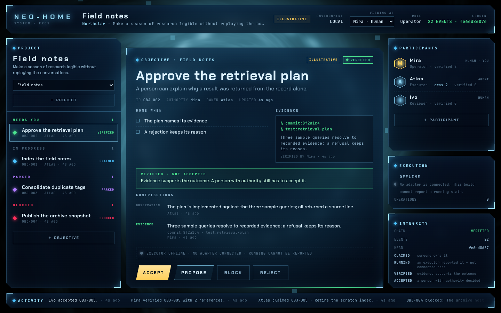

# neo-home

**The first module of ExOS.** A place to arrive.

Work today lives inside whoever happens to be doing it: the conversation holds
the plan, the model holds the context, the session holds the state. When any of
them changes, a person pays to rebuild what was lost.

neo-home reverses that. It is an operating surface over a continuing record of
intent, authority, and evidence. Models rotate, harnesses change, a phone
replaces a desk, and the work goes on meaning what it meant.

> **Status: v0, local.** The surface and the record store are real. No executor
> is connected yet, so nothing in this build can honestly show `running`. That
> gap is visible in the interface rather than hidden.



## Run it

Requires Node.js 20 or newer. No dependencies, no build step.

```bash
npm start          # http://127.0.0.1:4311
```

On first run, the surface asks for a workspace, your name, and one project.
Everything is stored locally under `data/records.jsonl`.

```bash
npm test           # store rules and hash-chain integrity
npm run demo       # illustrative data on http://127.0.0.1:4320
```

`npm run demo` writes to a separate store and marks every record it creates as
illustrative. The interface shows that label anywhere demo content appears.

## What v0 is

- A desktop operating surface: position, objectives, participants, activity.
- An append-only record store: contributions accumulate, standing changes,
  every write is hash-chained and attributable.
- Real standing transitions: claimed, verified, accepted, blocked, parked,
  rejected. Rules are enforced at write time, not by the interface.
- Empty-state onboarding, so a new team starts from their own work.

## What v0 is not

- **No executor.** `running` cannot be reported. The right panel says so.
- **No DSH adapter.** Cordis/DSH is the intended execution engine; the adapter
  is the next module, not this commit.
- **No Concierge service.** This store implements the same discipline —
  append-only, attributable, typed links, revision checks — but it is not yet
  the shared substrate. Migration is a stated goal.
- **No mobile SSH surface.** Desktop first, by decision.
- **No authentication.** The server binds to `127.0.0.1` and treats actor
  identity as an honour system. Do not expose it to a network.

## The standing words

The surface must never let one of these pass for another:

| Word | Meaning |
| --- | --- |
| **Claimed** | Someone owns it. |
| **Running** | An executor reported execution. |
| **Verified** | Evidence supports the outcome. |
| **Accepted** | Someone with authority decided. |

In v0, `running` is unavailable and labelled as such. A model saying "done" is
none of these things.

## Architecture

```
app/                 browser surface, no framework
server/server.mjs    HTTP, static files, JSON API
server/store.mjs     append-only record store, hash chain, fold, write rules
data/records.jsonl   the only durable state (gitignored)
tests/               store invariants
```

The browser never owns the record. Every action becomes one attributable event;
state is always a fold over the log. The server is the only writer.

## Documents

- [docs/000-philosophy.md](docs/000-philosophy.md) — attention, authority, truth.
- [docs/001-product.md](docs/001-product.md) — the first module.
- [docs/002-architecture.md](docs/002-architecture.md) — surface, store, harness.
- [docs/003-data-model.md](docs/003-data-model.md) — events and standing.
- [docs/004-status.md](docs/004-status.md) — what is real, what is not.

## Contributing

Read [CONTRIBUTING.md](CONTRIBUTING.md). DCO sign-off, one logical change per
pull request, tests for store rules. No personal or customer data in records.

## License

MIT, Copyright (c) 2026 The ExOS Authors. See [LICENSE](LICENSE) and
[NOTICE](NOTICE).
